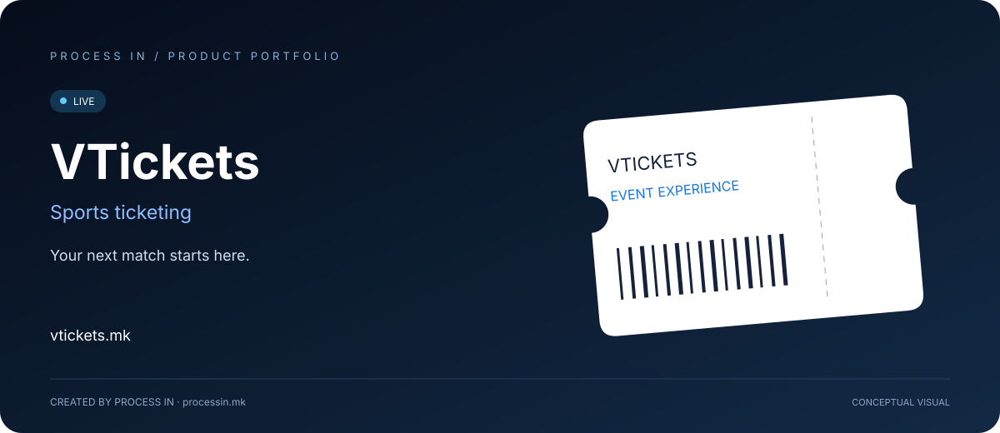

# VTickets

**Your next match starts here.**

[English](README.md) · [Македонски](README.mk.md)

**LIVE** · Confirmed by the owner

## The product

VTickets presents online ticket sales for RK Vardar matches. Fans can browse fixtures, review venue details and continue through the official ticketing experience.

## How to get started

| Step | Action |
|---|---|
| 01 | Choose a match |
| 02 | Review venue and time |
| 03 | Select an available ticket type |
| 04 | Complete the official purchase process |

## Core capabilities

| Area | What it offers |
|---|---|
| **Match listings** | Browse announced fixtures. |
| **Event details** | Review the venue and scheduled time. |
| **Ticket types** | Check the available ticket selection. |
| **Fan accounts** | Access registration and sign-in. |
| **Sales partners** | Dedicated sales-point access. |
| **News & contact** | Follow updates and contact support. |

## Who it is for

RK Vardar fans and ticket sales partners.

## Practical scenario

A supporter checks the fixture and venue before choosing tickets for a match.

## Product experience

The illustration above presents the product's purpose conceptually. Visit the official website for the current interface, available options and terms.

## Product information

| Detail | Value |
|---|---|
| Website | [vtickets.mk](https://vtickets.mk/) |
| Category | Sports ticketing |
| Status | LIVE |
| Developer | [PROCESS IN](https://processin.mk) |
| Portfolio contact | [contact@processin.mk](mailto:contact@processin.mk) |

Presentation sources: [1](https://vtickets.mk/).

### [Visit VTickets](https://vtickets.mk/)

[PROCESS IN — Your Enterprise Software & AI Partner](https://processin.mk)

---

Public product showcase. No proprietary application code, customer data or production secrets are included. This presentation does not grant an open-source license to the product.
